## 1. Linux 命令结构

> [!abstract] 命令通用骨架
> ```
> command  [-options]  arguments
>   命令      选项       参数（操作对象）
> ```
> 例：`ls -lah /home` → `ls` 是命令，`-lah` 是选项组合，`/home` 是参数。


>[!tip] 说明：
>1. [] 中括号表示 该部分可选，可有可无，需要根据命令的实际需要而添加;
>2. 命令、选项、参数都以空格分隔，不管几个空格都算一个空格;
>3. 命令输入完毕后，按回车“Enter”键启动;
### 选项（options）
- **短选项**：单横杠 + 单字母，可合并。`ls -l -a -h` = `ls -lah`
- **长选项**：双横杠 + 单词，可读性更好。`ls --all --human-readable`
- **带值选项**：`-o file` 或长选项 `--output=file`

### 参数（arguments）
命令作用的对象：文件名、目录、用户名、文本等。部分命令参数可选（单独 `ls` 即列出当前目录）。

### 多条命令的组合
| 连接符    | 含义              | 示例                        |
| ------ | --------------- | ------------------------- |
| `;`    | 依次执行，前一条成败都继续   | `cd dir; ls`              |
| `&&`   | 前一条**成功**才执行下一条 | `mkdir d && cd d`         |
| `\|\|` | 前一条**失败**才执行下一条 | `ping -c1 h \|\| echo 离线` |
| `&`    | 后台运行            | `sleep 10 &`              |

### 引号与转义
- **单引号 `'...'`**：强引用，内部一切按字面量，**不做任何展开**
- **双引号 `"..."`**：弱引用，允许 `$VAR`、`$(...)`、`` `...` ``、`\` 展开
- **反斜杠 `\`**：转义紧随其后的一个特殊字符

```bash
echo '$HOME'        # 原样输出 $HOME
echo "$HOME"        # 展开为家目录路径
echo "cost is \$5"  # 输出 cost is $5
```
### Shell和环境变量
[Shell基础入门](/blog/shell/)

## 2.目录/文件操作命令
### 1.pwd(打印当前路径)
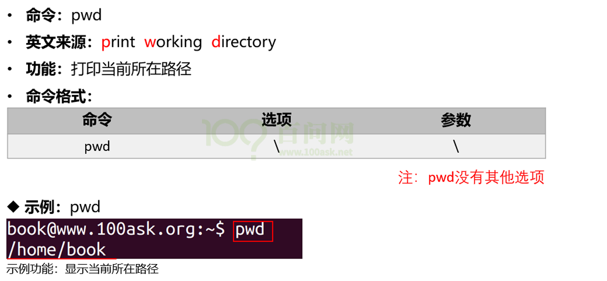
### 2.cd(切换/改变路径)

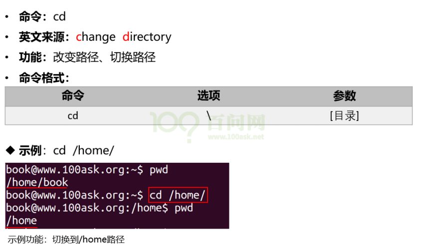

cd 命令有些缩略用法：
- <mark style="background:#ff4d4f">$ cd - </mark> 进入上次目录, 比如先进入 a 目录再进入 b 目录，执行此命令后即回到 a 目录
- <mark style="background:#ff4d4f">$ cd ~</mark> 进入家目录
### 3.mkdir(创建目录)
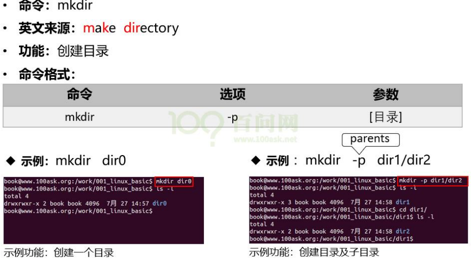

### 4.rmdir(删除目录)

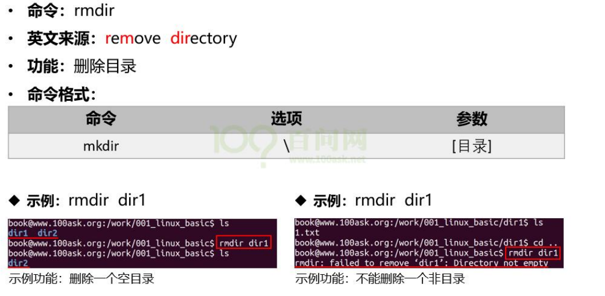

### 5.ls(列出目录内容)
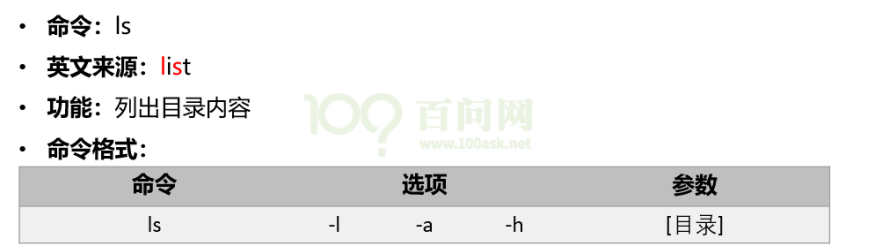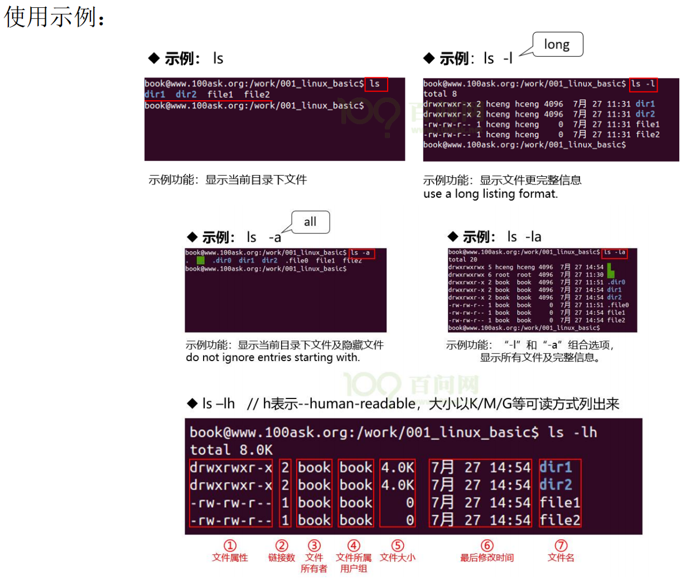

### 6.cp(复制)
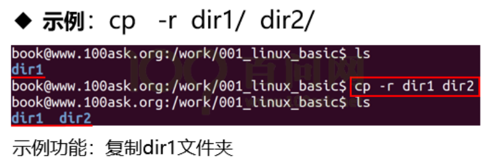

复制目录时，常用如下命令：

```shell
cp -rfd dir_a dir_b
```

- r：recursive，递归地，即复制所有文件
- f：force，强制覆盖
- d：如果源文件为链接文件，也只是把它作为链接文件复制过去，而不是复制实际文件

### 7.rm(删除文件或目录)
 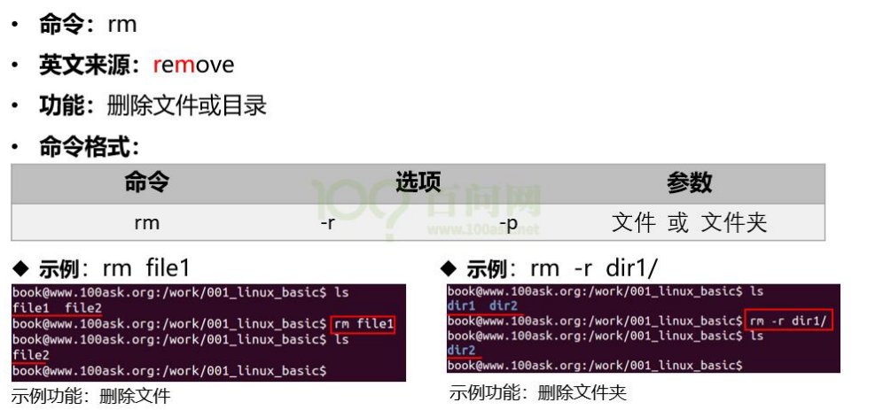

删除目录时，常用如下命令：

 ```bash
rm -rf dir_a        #<dir_a文件名>
 ```
 
- r：recursive，递归地，即删除所有文件
- f：force，强制删除
### 8.cat(串联文件的内容并打印出来)
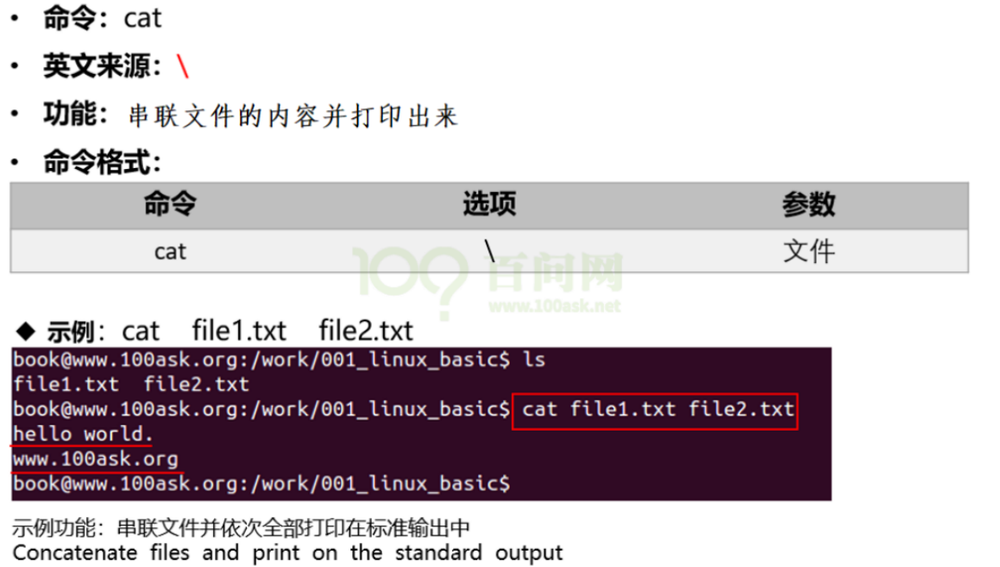

### 9.touch(修改时间戳)
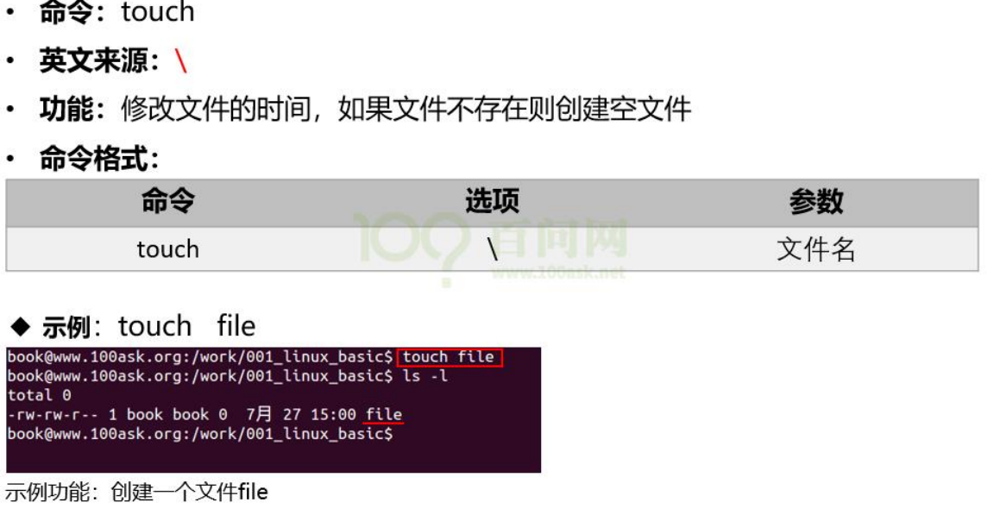

## 3.改变文件的权限和属性

- chgrp：改变文件所属用户组
- chown：改变文件所有者
- chmod：改变文件的权限
### 1. chgrp 改变文件所属用户组

```shell
chgrp [-R] dirname/filename ...
```
-  **-R:** 进行递归的持续更改，也连同子目录下的所有文件、目录都更新成为这个用户组之意。常常用在更改某一目录内所有文件的情况。

**范例：**

```shell
chgrp hy install.log
```

将 install.log 文件的用户组改为 hy 用户组。注意 hy 用户组必须要在/etc/group 文件内存在才可以。

### 2. chowm 改变文件的所有者

chown [-R] 账号名 文件或目录

chown [-R] 账号名:组名 文件或目录

 **-R**：也是递归子目录。

**范例：**
```shell
chown bin install.log
chown book:book install.log
```

改变文件所有者和用户组的这两个命令的应用场景：复制文件，由于复制行为会复制执行者的属性和权限，因此复制后需要改变文件所属用户、用户组等。

### 3. chmod 改变文件的权限

文件权限有两种设置方法：数字类型改变权限和符号改变权限。

首先说明各个权限对应的数字：

-  r(读): 4 或 0 (2^2)

-  w(写): 2或 0 (2^1)

-  x(执行): 1 或 0 (2^0)

- -（无权限）                           

这 3 种权限的取值相加后，就是权限的数字表示。
例如：文件 a 的权限为“-rwxrwx---”，它的数值表示为：

- owner(主) = rwx = 4+2+1 = 7

- group(组) = rwx = 4+2+1 = 7

- others(其他) = --- = 0+0 +0 = 0

所以在设置权限时，该文件的权限数字就是 770。

#### 1.数字类型改变权限

使用数值改变文件权限的命令如下：
```shell
chmod [-R] xyz <文件或目录>
```

-  xyz：代表权限的数值，如 770。

-  -R：以递归方式进行修改，比如修改某个目录下所有文件的属性。

**范例：**
```shell
chmod 777 .bashrc
```

将文件.bashrc 这个文件的所有权限设置都启用。

#### 2.符号类型改变文件权限方式

使用 u、g、o 三个字母代表 user、group、others 3 中身份。此外 a 代表

all，即所有身份。

**范例：**

```shell
chmod u=rwx,go=rx .bashrc
```


也可以增加或去除某种权限，“+”表示添加权限，“-”表示去除权限：
```shell 
chmod a+w .bashrc

chmod a-x .bashrc
```

---
## 4. 查找/搜索命令

### 1.find

在 Windows 中搜索文件，一般查找文件需要传入两个条件：

- 在哪些目录中查找；

- 查找的内容；

在 Linux 中，查找文件的也需要这两个条件，不同于 Windows 使用搜索框查找，Linux 中使用 find 命令查找文件。

find 命令格式为：

`find 目录名 选项 查找条件`

**举例 1：**

```shell
find /home/book/dira/ -name " test1.txt "
```


**说明:**

- /home/book/dira/指明了查找的路径。

-  “-name”表明以名字来查找文件 。

-  “test1.txt”，就指明查找名为“test1.txt”的文件。

**举例 2：**

$ find /home/book/dira/ -name " *.txt "

**说明:**

- 查找指定目录下面所有以“.txt”结尾的文件，其中“*”是通配符。

**举例 3：**
```shell
find /home/book/dira/ -name "dira"
```


- 说明: 查找指定目录下面是否存在“dira”这个目录或文件，“dira”是名称。

**<font color="#c00000">注意：</font>**

- 如果没有指定查找目录，则为当前目录。

```shell
find . -name " *.txt "  #其中.代表当前路径。

find -name " *.txt "    #没加路径，默认是当前路径下查找。
```


- find 还有一些高级的用法，如查找最近几天(几个小时)之内(之前)有变动的文件

```shell
find /home/book -mtime -2 //查找/home 目录下两天内有变动的文件。
```


### 2. grep

grep 命令的作用是查找文件中符合条件的字符串，其格式如下：

```shell
grep [选项] [查找模式] [文件名]
```


假设 dira 目录的 test1.txt 和 dirb 目录的 test1.txt 都含有如下内容：

```shell
aaaAAAAAA abc abcabcabc cbacbacba match_pattern nand->erase
```

通过查找字符串，希望显示如下内容：

- **所在的文件名:** grep 查找时默认已经显示目标文件名

- **所在的行号**:使用-n 选项

```shell
grep -rn "字符串" 文件名 
```

- r(recursive)：递归查找

- n(number)：显示目标位置的行号

- 字符串:要查找的字符串

- 文件名:要查找的目标文件，如果是*则表示查找当前目录下的所有文件和目录。

**举例：**

在 test1.txt 中查找字符串 abc grep -rn "abc" * 在当前目录递归查找字符串 abc
```shell
grep -n "abc" test1.txt
```

**注意：**

可以加入-w 全字匹配  `grep -rnw "abc" 

可以在 grep 的结果中再次执行 grep 搜索，比如搜索包含有 ABC 的头文件，可执行如下命令：

```shell
grep “ABC” * -nR | grep “\.h”
```


上述命令把第 1 个命令`grep “ABC” * -nR`通过管道传给第 2 个命令。即第 2个命令在第 1 个命令的结果中搜索。

## 5.压缩/解压缩命令
### 1.gzip

gzip 的常用选项：

-  -l(list) 列出压缩文件的内容。

-  -k(keep) 在压缩或解压时，保留输入文件。

-  -d(decompress) 将压缩文件进行解压缩。

**举例：**

- 查看压缩文件
```shell
gzip -l pwd.1.gz
```

- 解压文件
```shell
gzip -kd pwd.1.gz  #该压缩文件是以.gz 结尾的单个文件
```

- 压缩文件
```shell
gzip -k mypwd.1 #得到了一个.gz 结尾的压缩文件
```

**注意：**

- 如果 gzip 不加任何选项，此时为压缩。压缩完该文件会生成后缀为.gz 的压缩文件，并删除原来的文件。所以，推荐使用 gzip -k 来压缩源文件，这样会保留原来的文件。

- 相同的文件内容，如果文件名不同，压缩后的大小也不同。

- gzip 只能压缩单个文件，不能压缩目录。


### 2. bzip2

bzip2 的常用选项：
-  -k(keep)                在压缩或解压时，保留输入文件；

-  -d(decompress)    将压缩文件进行解压缩；

**压缩文件:**
`bzip2 -k mypwd.1`得到一个.bz2 后缀的压缩文。

**解压文件:**
`bzip2 -kd mypwd.1.bz2`

**注意：**

- 如果 bzip2 不加任何选项，此时为压缩37 / 566

- 压缩完该文件会生成后缀为.bz2 的压缩文件， 并删除原来的文件。所以说，推荐使用

- bzip2 -k 来压缩文件，这样可以保留原来的文件。

-  bzip2 只能压缩单个文件，不能压缩目录。

-  单个文件的压缩使用 gzip 或 bzip2，压缩有两个参数：

	a) 压缩时间
	b) 压缩比。

一般情况下，小文件使用 gzip 来压缩，大文件使用 bzip2 来压缩。bzip2 的的压缩率更高。

### 3. tar

tar 常用选项：

-  -c(create)：表示创建用来生成文件包 。

-  -x：表示提取，从文件包中提取文件。

-  -t：可以查看压缩的文件。

-  -z：使用 gzip 方式进行处理，它与”c“结合就表示压缩，与”x“结合就表示解压缩。

-  -j：使用 bzip2 方式进行处理，它与”c“结合就表示压缩，与”x“结合就表示解压缩。

-  -v(verbose)：详细报告 tar 处理的信息。

-  -f(file)：表示文件，后面接着一个文件名。 -C <指定目录> 解压到指定目录。

#### ***例 1：tar 打包、gzip 压缩***

1. 把目录 dira 压缩、打包为 dira.tar.gz 文件：

```shell
tar czvf dira.tar.gz dira
```

**注意：**“tar –czvf”与“tar czvf”是一样的效果，所以说，后面统一取消“-”。

2. 查看压缩文件：
```shell
tar tvf dira.tar.gz
```

3. 解压文件，可以用-C 指定解压到哪个目录：
```shell
tar xzvf dira.tar.gz #解压到当前目录
tar xzvf dira.tar.gz -C /home/book #解压到/home/book。
```

#### ***例 2：tar 打包、bzip2 压缩***

1. 把目录 dira 压缩、打包为 dira.tar.bz2 文件
```shell
tar cjvf dira.tar.bz2 dira
```


2. 查看压缩文件

```shell
tar tvf dira.tar.bz2
```

3. 解压文件，可以用-C 指定解压到哪个目录

```shell
tar xjvf dira.tar.bz2                 #解压到当前目录:
tar xjvf dira.tar.bz2 -C /home/book   #解压到/home/book
```

## 6.vi编译器

vi 是一个命令，也是一个命令行下的编辑器，比如在现场调试时，并没有 GUI 形式的编辑工具，那么vi 是唯一选择。

### 1. 模式

vi 编辑器有三种模式,各个模式侧重点不一样：
- 一般模式（光标移动、复制、粘贴、删除）
- 编辑模式（编辑文本）
- 命令行模式（查找和替换）

vi 编辑器的三种模式间切换如下图所示:
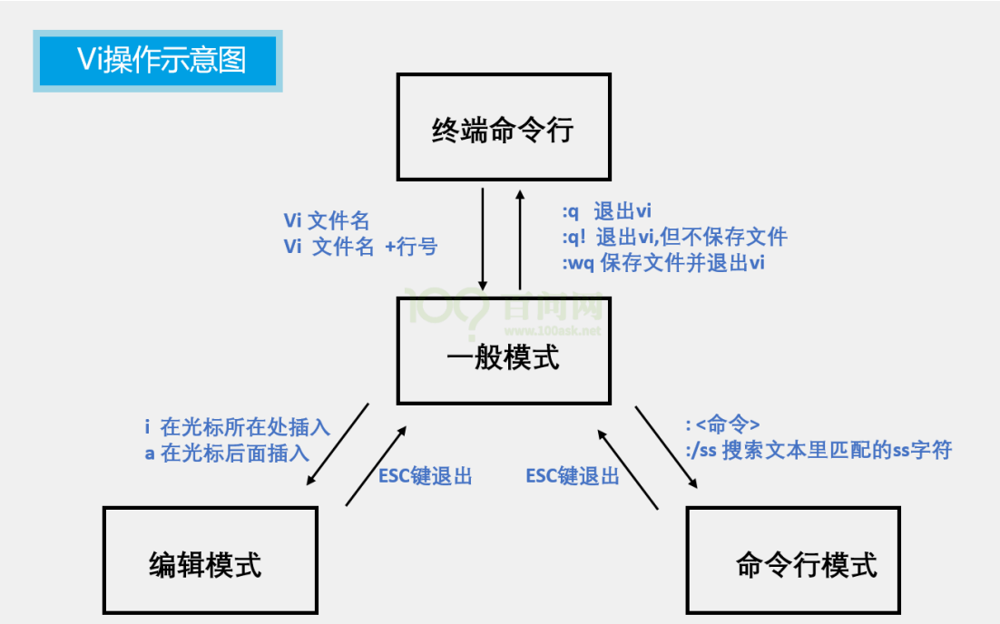
**注意：**
当不知道处于何种模式时，按 ESC 键返回到一般模式。
- wq(write quit)
- i(insert)

### 2.命令参考
| 命令    | 作用          | 何时用          | 注意点                   |
| ----- | ----------- | ------------ | --------------------- |
| `i`   | 光标 **前** 插入 | 开始打字前        | 进入编辑模式，打完记得按 `Esc` 出来 |
| `a`   | 光标 **后** 插入 | 想在当前字后面接着写   | 和 `i` 只差插入位置，按需选      |
| `Esc` | 回命令模式       | 每次编辑完        | **多按无害**              |
| `:wq` | 保存并退出       | 改完想存盘走人      | 冒号开头，回车执行             |
| `:q!` | 强制退出不保存     | 改乱了想放弃       | **不保存** ，改错时的后悔药      |
| `dd`  | 删除（剪下）当前行   | 删行、挪行        | 删的内容进寄存器，可被 `p` 粘出    |
| `yy`  | 复制当前行       | 复制一行         | 配合 `p` 使用，`nyy` 可复制多行 |
| `p`   | 粘贴到下方       | 粘出 dd/yy 的内容 | 大写 `P` 是粘到上方          |
| `u`   | 撤销          | 操作错了         | 可连按，多级撤销              |
| `/`   | 向下搜索        | 找内容          | 输完回车，`n` 跳下一个         |
其他命令：
https://www.runoob.com/linux/linux-command-manual.html